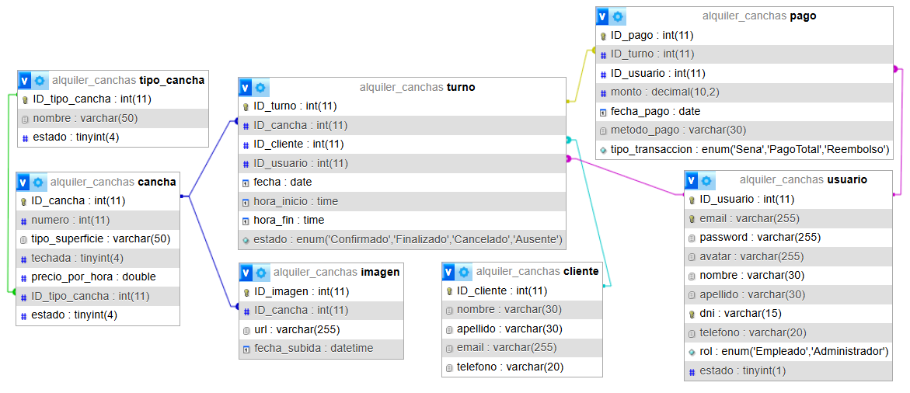

# Alquiler de Canchas

Sistema web MVC (ASP.NET Core) para la gestión del alquiler de canchas deportivas: administra canchas, clientes, turnos (reservas) y pagos, con acceso diferenciado por rol para el personal del complejo.

## Problema que resuelve

Los complejos deportivos suelen llevar las reservas en cuadernos o chats, lo que genera turnos superpuestos, pagos sin registrar y poca visibilidad de qué se cobró. Este sistema centraliza:

- El catálogo de **canchas** (tipo, superficie, techada, precio por hora) y sus fotos.
- La agenda de **turnos** por cancha y cliente, con su estado (Confirmado, Finalizado, Cancelado, Ausente).
- El registro de **pagos** (seña, pago total, reembolso) asociados a cada turno.
- La gestión de **empleados** y permisos por rol.

## Tecnologías

- ASP.NET Core MVC (C#), .NET 9
- MySQL (XAMPP) con ADO.NET (repositorios) y Entity Framework Core + Pomelo
- Autenticación por cookies (sitio web) y JWT Bearer (Web API)
- JavaScript con `fetch`/AJAX y Select2 en los módulos dinámicos

## Modelo de datos

Diagrama Entidad-Relación: [`/docs/der.png`](docs/der.png)

Entidades: `Usuario`, `Cliente`, `TipoCancha`, `Cancha`, `Imagen`, `Turno`, `Pago`.

- 1:N: `TipoCancha → Cancha`, `Cancha → Imagen`, `Turno → Pago`.
- `Turno` depende de otras tres entidades: `Cancha`, `Cliente` y `Usuario`.

## Cómo ejecutarlo en local

1. Iniciar **MySQL** desde XAMPP.
2. Importar `AlquilerDeCancha.sql` en phpMyAdmin (pestaña SQL). Crea la base `alquiler_canchas`, las tablas y los datos de prueba.
3. Revisar en `appsettings.json` la cadena de conexión (`ConnectionStrings:DefaultConnection`) y la sección `Jwt` (`Key` de al menos 32 caracteres, `Issuer`, `Audience`).
4. Ejecutar:
   ```bash
   dotnet restore
   dotnet run
   ```
5. Abrir la URL que indica la consola (por ejemplo `https://localhost:xxxx`).

## Usuarios de prueba

| Rol | Email | Contraseña |
|---|---|---|
| Administrador | `admin@canchas.com` | `Admin123!` |
| Empleado | `empleado@canchas.com` | `Empleado123!` |

- **Empleado**: gestiona clientes, turnos y pagos.
- **Administrador**: todo lo del empleado, y además gestiona empleados y canchas, y puede eliminar pagos.

## Matriz de evidencias de requerimientos mínimos

Estado actual del proyecto (entrega para **regularizar**).

| Requerimiento mínimo | Estado | Enlace al código / controladores | Evidencia (captura / GIF / video) |
|---|---|---|---|
| 1. 6+ tablas y relación 1:N (Turno depende de Cancha + Cliente + Usuario) | ✅ Cumplido | [DataContext.cs](Models/DataContext.cs), [AlquilerDeCancha.sql](AlquilerDeCancha.sql) |  <br> 7 tablas. 1:N: TipoCancha→Cancha, Cancha→Imagen, Turno→Pago. Turno depende de Cancha + Cliente + Usuario |
| 2. Login, roles y avatar | 🟡 En progreso (login y roles listos; avatar a confirmar) | [UsuarioController.cs](Controllers/UsuarioController.cs), [Program.cs](Program.cs) | _Pendiente: captura de perfil con avatar_ |
| 3. Manejo de archivos (fotos de canchas) | 🟡 En progreso | [CanchaController.cs](Controllers/CanchaController.cs), [Imagen.cs](Models/Imagen.cs) | _Pendiente: GIF de subida de imágenes_ |
| 4. ABM completo con Vue.js/AJAX (Pagos) | 🟡 En progreso (endpoints JSON listos) | [PagoController.cs](Controllers/PagoController.cs) (`Listar`, `Crear`, `Editar`, `Eliminar`), `Views/Pago/Index.cshtml` | _Pendiente: GIF del ABM sin recarga_ |
| 5. Paginado por servidor | ✅ Cumplido (Pagos) | [PagoController.cs → Listar](Controllers/PagoController.cs) | _Pendiente: captura del inspector de red con `pagina=2`_ |
| 6. Selección asíncrona de entidades relacionadas | ✅ Cumplido (Pagos → Turno) | [PagoController.cs → BuscarTurnos](Controllers/PagoController.cs) | _Pendiente: GIF del desplegable buscando turnos_ |
| 7. Web API + JWT | 🟡 En progreso (login JWT listo) | [AuthApiController.cs](Controllers/Api/AuthApiController.cs), [Program.cs](Program.cs) | _Pendiente: captura de Postman con Bearer Token_ |

> Leyenda: ✅ cumplido · 🟡 en progreso · ❌ pendiente.

## Estructura del repositorio

```
Controllers/        Controladores MVC y Api/ (JWT)
Models/             Entidades, DataContext y repositorios
Views/              Vistas Razor
wwwroot/            Recursos estáticos y archivos subidos
docs/               DER y colección de Postman
AlquilerDeCancha.sql  Script de base de datos con datos de prueba
```

